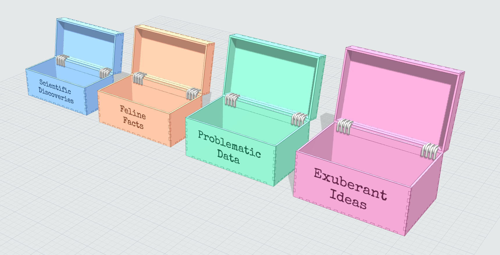
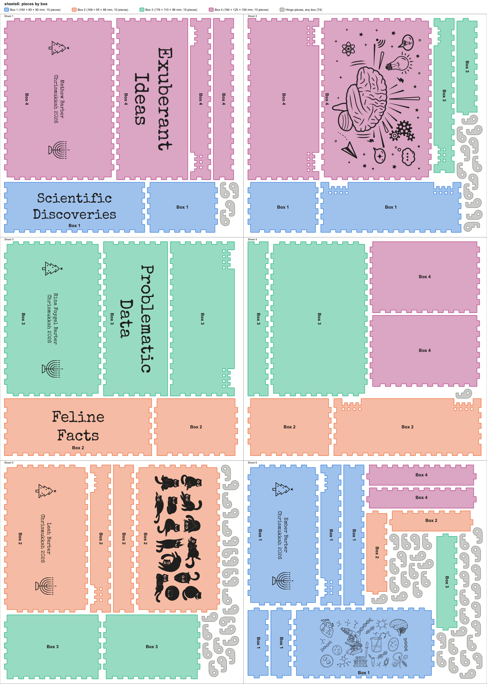
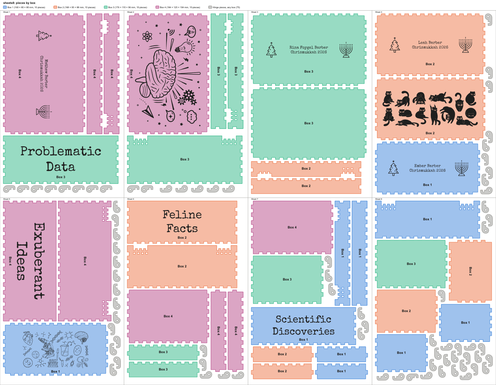
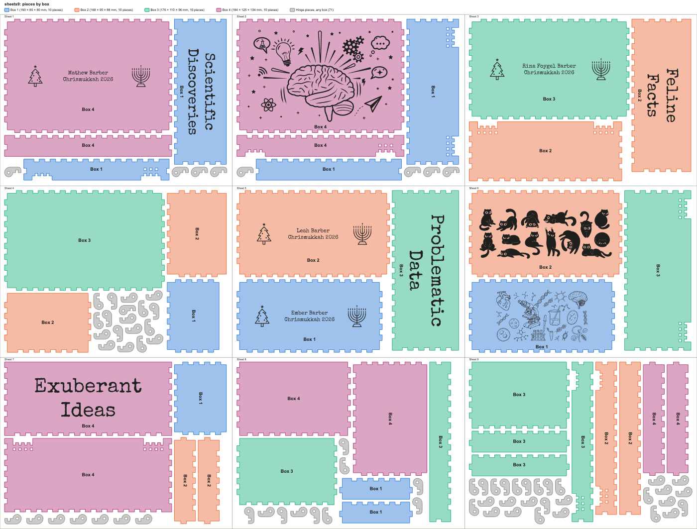
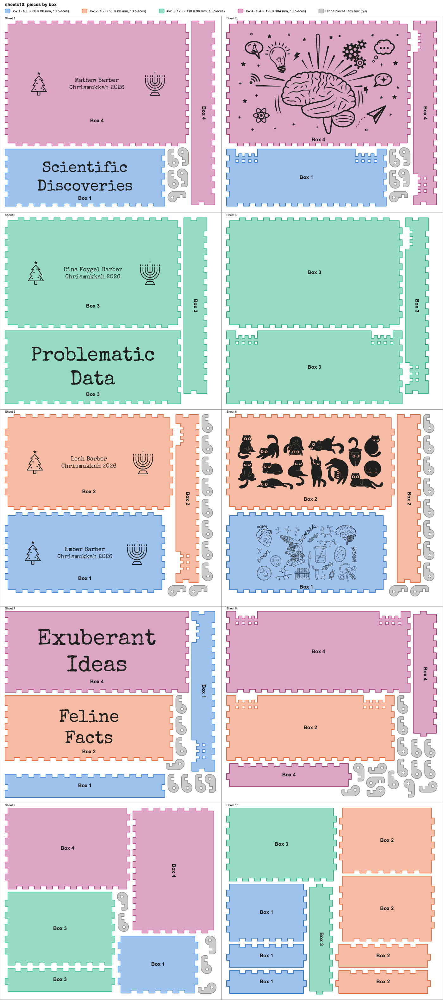
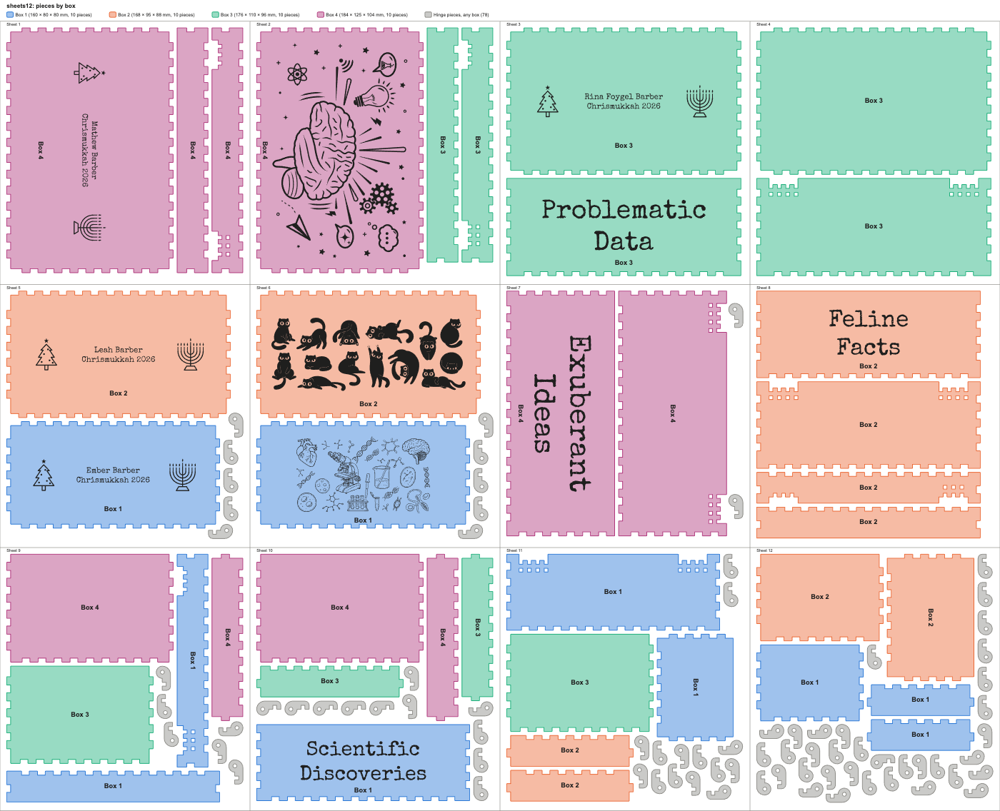

# Four nested HingeBoxes

A set of four laser-cut wooden boxes, each one sized to fit inside the next, made as
Chrismukkah 2026 gifts. Each box is a stock boxes.py
[HingeBox](https://boxes.hackerspace-bamberg.de/HingeBox) (`boxes/generators/hingebox.py`)
in 3 mm plywood, with a lid on two wooden hinges built from 7 interlocking pieces and
a metal pin each. The front of each box is engraved with a title in the typewriter
face Special Elite, and the bottom with the recipient's name and "Chrismukkah 2026"
between a small Christmas tree and a menorah. Box 1's lid top also carries an
ink-sketch science illustration (microscope, DNA, heart, brain and lab glassware),
box 2's a row of black cat silhouettes, and box 4's a brain bursting with ideas.

| Box | Outside (mm) | Front | Bottom |
|---|---|---|---|
| 1 (innermost) | 160 × 80 × 80 | Scientific Discoveries | Ember Barber |
| 2 | 168 × 95 × 88 | Feline Facts | Leah Barber |
| 3 | 176 × 110 × 96 | Problematic Data | Rina Foygel Barber |
| 4 (outermost) | 184 × 125 × 104 | Exuberant Ideas | Mathew Barber |

The project covers:

* **Sizing.** Working out from the generator code how much smaller each box must be
  to fit inside the next, hinges included ([sections 1–2](#1-how-much-smaller-the-inner-box-must-be)).
* **Cut files.** Packing every piece of all four boxes onto N equal sheets that sit side
  by side and are cut from one large sheet, so the cut sheets stack flat for travel.
  Leftover space is filled with spare hinge pieces ([section 3](#3-n-equal-sheets-with-spare-hinge-pieces)).
* **[A 3D model](https://danfoygel.github.io/boxes/nested-hingeboxes/)** to rotate,
  nest and open the boxes in the browser ([section 4](#4-3d-model)).
* **Engraved text** on the front and bottom of each box, with a tree and a menorah
  beside the bottom text, and **artwork** on the lids of boxes 1, 2 and 4, in the cut
  files and the model ([section 5](#5-engraved-text)).

## 3D model

[Open the 3D model](https://danfoygel.github.io/boxes/nested-hingeboxes/) to rotate the
boxes, nest them inside each other, open the lids and look underneath. It is
[`model.html`](model.html), which you can also open locally in a browser. The GitHub
Pages workflow publishes it with each push to `master`.



## Layouts

There are five layouts, with 6, 8, 9, 10 or 12 sheets. Each one holds every piece of
all four boxes plus as many spare hinge pieces as fit. Every piece is at least 3 mm
from its neighbours and 5 mm inside its sheet's cut line. The pictures below are the
colour-coded views from `layouts/`: blue is box 1, orange box 2, aqua box 3, plum box 4,
and grey the hinge pieces, which fit any box. Cut from the files in `sheets/`, which
have the same layout in boxes.py's cut colours. [Section 3](#comparison-of-all-options)
compares the options in full.

### 6 sheets

278 × 255 mm (10.94 × 10.04 in) each, in a 2 × 3 grid (556 × 765 mm overall). 18 spare
hinge pieces, 79.3% utilization. Uses the least material. Cut file:
[`sheets/sheets6.svg`](sheets/sheets6.svg).



### 8 sheets

190 × 287 mm (7.48 × 11.30 in) each, in a 4 × 2 grid (760 × 574 mm overall). 19 spare
hinge pieces, 77.3% utilization. Cut file: [`sheets/sheets8.svg`](sheets/sheets8.svg).



### 9 sheets

256 × 189 mm (10.08 × 7.44 in) each, in a 3 × 3 grid (768 × 567 mm overall). 15 spare
hinge pieces, 77.4% utilization. Cut file: [`sheets/sheets9.svg`](sheets/sheets9.svg).



### 10 sheets

222 × 197 mm (8.74 × 7.76 in) each, in a 2 × 5 grid (444 × 985 mm overall). 3 spare
hinge pieces, 76.7% utilization. Cut file:
[`sheets/sheets10.svg`](sheets/sheets10.svg).



### 12 sheets

188 × 198 mm (7.40 × 7.80 in) each, in a 4 × 3 grid (752 × 594 mm overall). 22 spare
hinge pieces, 75.6% utilization. Cut file:
[`sheets/sheets12.svg`](sheets/sheets12.svg).



## Files

| Path | What it is |
|---|---|
| `generate.sh` | Regenerates every SVG in this folder |
| `pack_sheets.py` | Packs all pieces onto N equal sheets laid out in a grid, with cut lines between sheets, and fills the leftover space with spare hinge pieces; when only the engraving has changed it keeps the layout and updates the engraving |
| `check_layout.py` | Checks a multi-sheet file from the SVG alone: every gap ≥ 3 mm, every piece ≥ 5 mm inside its sheet |
| `color_layouts.py` | Makes the colour-coded layout views in `layouts/` |
| `compare.py` | Prints the comparison table of all layouts |
| `render_previews.js` | Renders the SVGs to PNG previews and screenshots the 3D model (Playwright + Chromium) |
| `engraving.py` | The engraving: the words, their sizes, and their outlines in Special Elite, the tree and menorah beside the bottom text, and the lid artwork scaled to fit |
| `engrave_boxes.py` | Adds the engraving to the box SVGs |
| `fonts/` | Special Elite (`SpecialElite-Regular.ttf`, from Google Fonts) and its licence (Apache 2.0) |
| `art/` | The lid artwork: the Adobe Stock Illustrator EPS files converted to SVG, 2095995062 (box 1) and 939770434 (box 2), and `ideas.svg` (box 4), drawn by `draw_ideas.py` |
| `make_model.py`, `model_template.html` | Build `model.html`, the interactive 3D model |
| `model.html` | The four boxes in 3D: open it in a browser to rotate, nest and open them |
| `boxes/box1.svg` … `box4.svg` | The four boxes, each from the stock HingeBox generator (7-piece hinges), plus their engraved text and lid artwork |
| `sheets/sheetsN.svg` | N equal sheets, with spare hinge pieces: the cut files |
| `layouts/sheetsN.svg` | The same layouts colour-coded by box, for reading, not cutting |
| `previews/` | PNG renders of the cut files (`sheetsN.png`), layout views (`layout-sheetsN.png`) and 3D model (`model.png`) |

## The requests

1. *Look at the HingeBox design and figure out the offsets needed for another box of
   the same design to fit inside.*
2. *Use offset 8 for x and z and 15 for y. Four nested boxes, the innermost is
   160 × 80 × 80 mm. Calculate the other boxes.* Then convert those to inches, and
   explain "outside" mode.
3. *Lay out all the pieces for the four sizes on a single SVG cutsheet.*
4. *Split it into multiple sheets for packing as a protected stack for travel. All
   sheets must be the same size and sit side by side in the overall layout, with cut
   lines for each sheet, so they can be cut from one larger sheet of material. Find
   the best layout for 6, 8, 9 and 10 sheets and report the sheet size and overall
   utilization.*
5. *Recalculate without keeping each box's hinge pieces together.*
6. *Add a 12-sheet layout and a table comparing all the options.*
7. *Drop the clustered layouts. For the others, fit as many extra hinge pieces as
   possible without making the sheets bigger.*
8. *Build each hinge from 7 pieces instead of 5 to make it stronger.* Then: *remove
   the single cutsheet.* And: *make layout SVGs where each piece is colour-coded by
   box.*
9. *Generate a 3D model of the box that I can view and rotate in the browser.* Then:
   *let me look under the boxes.*
10. *Add text to the front of each box, in the 3D viewer only for now:* Scientific
    Discoveries, Feline Facts, Problematic Data, Exuberant Ideas. Then: *use Special
    Elite.* And: *split the text to two lines, as large as fits with good padding, the
    same size on all four.* Then: *keep box 1's size and scale the others in
    proportion to their sizes.*
11. *Add text on the bottom of the boxes:* each recipient's name (Ember Barber, Leah
    Barber, Rina Foygel Barber, Mathew Barber), then "Chrismukkah 2026". Then: *try
    6 mm, and rotate it 180 degrees.* And then: *rotate it 180 degrees* again.
12. *Add the text to the layouts and cut files.*
13. *Add small engraved images of a Christmas tree and a menorah on the bottom:* line
    art, one either side of the text.
14. *Add this as a raster to box 1 lid:* an Adobe Stock illustration (2095995062),
    first converted from `.ai` to SVG.
15. *Do the same with this file for box 2:* Adobe Stock 939770434.
16. *For box 4 lid, design an SVG that's inspired by this design* (a stock clip-art
    brain bursting with a light bulb, gears and speech bubbles). *However, I want it to
    have a wider aspect ratio to better fit the lid, and absolutely no text, just
    graphics.*

The single cutsheet (request 3) and the clustered layouts (request 4) have since been
removed. The repository history has them.

## 1. How much smaller the inner box must be

From the HingeBox generator code (`CabinetHingeEdge` in `boxes/edges.py`, default
`inside` hinge style), checked against a rendered SVG:

* **The pivot is on the outside face of the back wall.** Each hinge piece hooks
  through a slot and a t × t hole in the back wall. Its knuckle (radius `eye` = 1.5t)
  is centred on the line where box and lid meet, at the outer face. So the knuckles
  stick out **1.5t behind the box**: the real depth is y + 2t + 1.5t.
* **The hinge pieces reach 1t into the interior** from the back wall, in a band from
  4.5t (`eye` + 3t) below the box/lid joint to 4.5t above it.
* **The interior height of the closed box is h + lidheight.** Box and lid walls meet
  with no gap.

Minimum offsets for the next smaller box (same thickness t, default hinge settings):

| Dimension | Inner box | t = 3 mm |
|---|---|---|
| x | X − 2t − gap | X − 6 − gap |
| y | Y − 2t − 1.5t − 1t − gap = Y − 4.5t − gap | Y − 13.5 − gap |
| h + lidheight | H + LH − 2t − gap | H + LH − 6 − gap |

In y, 2t is the inner box's walls, 1.5t its knuckles and 1t the outer box's hinge
pieces.

* If the inner box's total closed height stays below the outer hinge band
  (h + lidheight + 2t ≤ H − 4.5t − gap), the y offset drops to 3.5t.
* The inner box can't fully open while inside the outer one, because its lid swings
  back past its back wall. Allow about lidheight + t more in y if it must open in place.
* Different thicknesses (outer T, inner t): x −2t, y −(2t + 1.5t + T), height −2t.

## 2. The four boxes

The chosen offsets are **8 mm for x and height, 15 mm for y**. With 3 mm material that
leaves about 2 mm of play in x and height and 1.5 mm in y. That works for material up
to about 3.3 mm thick; at that thickness y has no play left.

All boxes use outside dimensions, `--thickness 3`, `--lidheight 20` and
`--CabinetHinge_eyes_per_hinge 7`. Outside mode is HingeBox's default, and
`generate.sh` leaves it on. The closed height is split as h + 20 (see
[Outside mode](#outside-mode) for why).

Sizes are width × depth × closed height. The outside depth doesn't include the hinge
knuckles, which stick out another 4.5 mm at the back.

| Box | Outside (mm) | `--h` | Outside (in) | Inside (mm) |
|---|---|---|---|---|
| 1 (innermost) | 160 × 80 × 80 | 60 | 6.30 × 3.15 × 3.15 | 154 × 74 × 74 |
| 2 | 168 × 95 × 88 | 68 | 6.61 × 3.74 × 3.46 | 162 × 89 × 82 |
| 3 | 176 × 110 × 96 | 76 | 6.93 × 4.33 × 3.78 | 170 × 104 × 90 |
| 4 (outermost) | 184 × 125 × 104 | 84 | 7.24 × 4.92 × 4.09 | 178 × 119 × 98 |

Inside, each box is 6 mm (2t) smaller than outside in every direction. The inside
height is the box's h − 6 plus the 20 mm lid, for example 54 + 20 for box 1. Each box's
outside is 2 mm narrower and 2 mm lower than the next box's inside. In depth it is
1.5 mm short, once its knuckles (4.5 mm) and the outer box's hinge pieces (3 mm) are
counted.

With the knuckles, the outermost box takes up 184 × 129.5 × 104 mm
(7.24 × 5.10 × 4.09 in).

### Outside mode

boxes.py's `outside` option treats x/y/h as outer instead of inner dimensions and
subtracts the walls. For HingeBox there are three exceptions:

* `lidheight` is always an inside measure.
* h becomes the closed outside height minus `lidheight`, because the generator
  subtracts 2t from h although the hinge edge at the top has no wall.
* The hinge knuckles stick out 1.5t beyond y.

The offsets above work in either mode, as long as all boxes use the same mode and
thickness.

### 7-piece hinges

Each box has 2 hinges, and each hinge is now built from 7 pieces instead of the
generator's default 5: 4 attached to the box's back wall and 3 to the lid's, alternating
on one pin. So each box has 14 hinge pieces, 56 for all four. The pieces themselves are
unchanged. The back walls get 4 t × t holes per hinge (lid walls 3), and each hinge's
cut-out in the wall edge is 2 × (t + play) = 6.3 mm wider. That widens the bearing
surface on the pin from about 16 mm to about 22 mm per hinge.

Nesting is unaffected: the hinge pieces have the same shape and sit in the same
place, so the knuckle and interior offsets above still hold. The hinges get wider, but
the innermost box (154 mm wide inside) still has plenty of room for two of them.

## 3. N equal sheets with spare hinge pieces

Every piece is at least 5 mm inside its sheet's cut line, which leaves a protective
frame, and 3 mm from every other piece. The sheets sit in the grid closest to square,
and neighbours share one cut line.

How `pack_sheets.py` builds a layout:

1. **Sheet size.** The size search finds the smallest sheet into which a rectangle
   packer (rectpack, several algorithms and sort orders, 90° rotation) fits every
   piece's bounding box. It ran with the 5-piece hinges, and those sizes are kept
   (`--sheet` in `generate.sh`). A sheet grows, in 2 mm steps and smallest area
   first, only if the required pieces no longer fit. With 7-piece hinges, only the
   8-sheet layout had to grow, from 188 × 285 to 190 × 287 mm.
2. **Spare hinge pieces at that fixed size.** The hinge pieces are identical for all
   four boxes, so any spare fits any box. Each layout is tried both ways:
   * **A:** the box pieces plus k hinge pieces are packed as rectangles, then more
     hinge pieces are dropped into the leftover space by their real outline.
   * **B:** the same packing, but the rectangle-placed hinge pieces are removed and
     every hinge piece is placed by outline.

   This runs for several k and every packer setting that fits. Placing by outline
   uses all 4 rotations, top-left first, in 0.25 mm steps. A fast grid test proposes
   positions, and each one is checked exactly against the real outlines. That lets the
   hook-shaped pieces interlock and tuck in beside the finger joints. The layout with
   the most hinge pieces wins.
3. **Independent check.** `check_layout.py` re-reads every finished SVG and confirms
   each gap is ≥ 3 mm and each piece is ≥ 5 mm inside its sheet. All layouts pass.

Spare pieces are unlabelled like the other hinge pieces. Cut them all; any 14 make one
box's hinges (2 hinges × 7 pieces).

All of this is heuristic: these are the best layouts found, not proven optima.

### Comparison of all options

Utilization = real area of the cut pieces in the file (outlines minus holes and
finger notches, spare hinge pieces included) / total sheet area. "vs best" is the
extra material compared with the smallest layout. The table is the output of
`compare.py`.

| Sheets | Sheet (mm) | Sheet (in) | Grid | Overall (mm) | Overall (in) | Material (m²) | vs best | Hinge pieces | Utilization |
|---|---|---|---|---|---|---|---|---|---|
| **6** | **278 × 255** | **10.94 × 10.04** | **2 × 3** | **556 × 765** | **21.89 × 30.12** | **0.425** | **best** | **74 (+18 spare)** | **79.3%** |
| 8 | 190 × 287 | 7.48 × 11.30 | 4 × 2 | 760 × 574 | 29.92 × 22.60 | 0.436 | +2.6% | 75 (+19 spare) | 77.3% |
| 9 | 256 × 189 | 10.08 × 7.44 | 3 × 3 | 768 × 567 | 30.24 × 22.32 | 0.435 | +2.4% | 71 (+15 spare) | 77.4% |
| 10 | 222 × 197 | 8.74 × 7.76 | 2 × 5 | 444 × 985 | 17.48 × 38.78 | 0.437 | +2.8% | 59 (+3 spare) | 76.7% |
| 12 | 188 × 198 | 7.40 × 7.80 | 4 × 3 | 752 × 594 | 29.61 × 23.39 | 0.447 | +5.0% | 78 (+22 spare) | 75.6% |

56 hinge pieces are needed (4 boxes × 2 hinges × 7).

Takeaways:

* **6 sheets uses the least material** and still fits 18 spare hinge pieces, enough
  for one more box's hinges.
* **The 7-piece hinges fit at unchanged sheet sizes everywhere except 8 sheets.** The
  16 extra required pieces come out of the spares, so 6, 9, 10 and 12 sheets each
  hold the same total number of hinge pieces as before.
* **8 sheets grew by 2 mm each way** (+1.8% material). The larger sheet happened to
  pack much better, so it now holds 19 spares instead of 8.
* **10 sheets has only 3 spares**, the fewest of any layout.
* How many spares fit depends on where the packer happens to leave gaps, not just on
  total free area.

### Colour-coded layout views

`layouts/sheetsN.svg` shows each cut file with every piece filled in its box's colour.
A legend at the top gives each box's size and piece count.

| Box 1 | Box 2 | Box 3 | Box 4 | Hinge pieces |
|---|---|---|---|---|
| blue `#2a78d6` | orange `#eb6834` | aqua `#1baf7a` | plum `#b0367c` | grey `#8a8984` |

Pieces are filled with a light tint and outlined in the full colour. Hinge pieces are
grey because any of them fits any box. Pieces from all four boxes sit next to each
other, so the four colours were checked as a set, every pair against every other: the
worst pair is ΔE 20.4 apart for normal colour vision and 9.2 for the common forms of
colour blindness. Every piece still carries its "Box N" label, so colour is never the
only cue. These files are for reading the layout; cut from `sheets/`.

## 4. 3D model

`model.html` shows all four boxes assembled. Open it in a browser (it loads three.js
from a CDN). Drag to orbit, scroll to zoom, right-drag to pan.

* **Nested** puts each box inside the next one out, centred, resting on its bottom.
  The outer boxes can be made see-through. Only the outermost box shown opens, since
  the inner lids can't swing back inside it.
* **Side by side** lines the boxes up and opens every lid.
* The lid slider turns the lids about their hinge pins, 0–110°.
* Colour by box (the colours above, hinge pieces grey) or as plywood.
* Hovering a piece names it, with its flat size.
* Each box carries its engraved text (section 5) on its front and underneath, and
  boxes 1, 2 and 4 their artwork on the lid top. The model draws the same outlines as the
  cut files.

How `make_model.py` builds it:

1. It runs the stock HingeBox generator with the `generate.sh` settings, but with no
   kerf (`--burn 0`) so the pieces meet exactly.
2. While each wall is drawn, it records the drawing frame at the wall's inner corner.
   That turns the wall's paths into wall coordinates, so the outline (finger joints,
   hinge cut-outs and holes included) is the generator's own, not a redrawing.
3. Each wall is extruded to 3 mm and folded into place. The hinge pieces go where the
   generator cut the t × t holes for them in the back walls, and each hinge gets a
   3 mm pin.

A voxel check at 0.25 mm found no overlap between any two pieces of a box, and none
between the boxes when nested.

## 5. Engraved text

Each box has text engraved on its front and underneath, in the typewriter face
[Special Elite](https://fonts.google.com/specimen/Special+Elite). The words and sizes
are set in `engraving.py`, which turns the text into outlines with the font in
`fonts/`, so the laser software doesn't need the font installed. The cut files, the
layout views and the 3D model all use these same outlines.

**Front.** Two lines, centred on the front wall of the box (not the lid), the top of
the text towards the open top edge. Box 1 gets the largest font size that leaves
12 mm clear on every side of its 54 mm high front: 15.4 mm. The other boxes scale up
from it in proportion to the height of their fronts, so the text takes up the same
share of each front's height.

| Box | Front text | Front (mm) | Font size (mm) |
|---|---|---|---|
| 1 | Scientific / Discoveries | 154 × 54 | 15.4 |
| 2 | Feline / Facts | 162 × 62 | 17.7 |
| 3 | Problematic / Data | 170 × 70 | 20.0 |
| 4 | Exuberant / Ideas | 178 × 78 | 22.3 |

**Bottom.** The recipient's name, then "Chrismukkah 2026", at 6 mm on all four
(capitals about 4.1 mm high), centred. It reads right way up when you tip the box
back to look underneath, front edge at the top. In the 3D model that is how it shows
when you orbit under the box from the front.

| Box | Bottom text | Bottom (mm) |
|---|---|---|
| 1 | Ember Barber / Chrismukkah 2026 | 154 × 74 |
| 2 | Leah Barber / Chrismukkah 2026 | 162 × 89 |
| 3 | Rina Foygel Barber / Chrismukkah 2026 | 170 × 104 |
| 4 | Mathew Barber / Chrismukkah 2026 | 178 × 119 |

**Tree and menorah.** Beside the bottom text, a line-art Christmas tree on the left
and a nine-branch menorah (the shamash raised in the middle) on the right, the same
on all four boxes. Each is centred halfway between the text and the edge of the
bottom's inner area, level with the text. They're drawn in `engraving.py` as lines
and filled shapes and turned into outlines with shapely: 0.7 mm lines (0.55 mm for
the candles), with the flames, the star and the ornaments filled. The menorah is
19.8 × 24.4 mm and the tree 16.1 × 24.1 mm, at the same scale (`ART_H` sets it).

| Box | Gap either side of the tree (mm) | Gap either side of the menorah (mm) |
|---|---|---|
| 1 | 16.7 | 14.9 |
| 2 | 18.7 | 16.9 |
| 3 | 19.7 | 17.9 |
| 4 | 22.7 | 20.9 |

In the cut files the text and art are green (boxes.py's etching colour), filled outlines inside
the piece it belongs to. `engrave_boxes.py` adds it to the box SVGs from the generator,
so it moves with its piece when the sheets are packed. Adding it changed no piece's
size, so the sheet layouts are the same as before. On those two pieces the red
"Box N" label moves down, between the engraving and the piece's lower edge.

* **The engraved face goes outside.** Engrave with the sheet as it lies; when you
  assemble, turn each engraved piece so its engraved face is outward. Both pieces are
  symmetric (`engrave_boxes.py` checks this), so that always fits.
* **The bottom has no fixed front.** Its two long edges are the same, so whichever one
  the top of the text points to becomes the front edge.
* **Which panel is the bottom.** Each box has two identical x × y panels, the bottom
  and the lid top. The engraved one is the bottom.

### Lid artwork

The lid tops of boxes 1 and 2 are engraved with Adobe Stock illustrations. Both stock
files are Illustrator EPS with a `.ai` extension. Each was turned into a PDF with
Ghostscript and then into an SVG in `art/` with PyMuPDF. Box 4's is an original
drawing, made for this lid.

| Box | Artwork | Lid top (mm) | Engraved (mm) |
|---|---|---|---|
| 1 | Science and medical research in blue-ink sketch style (`AdobeStock_2095995062.svg`) | 154 × 74 | 100.3 × 58.0 |
| 2 | Black cat silhouettes in 15 poses (`AdobeStock_939770434.svg`) | 162 × 89 | 146.0 × 55.0 |
| 4 | A brain bursting with ideas, no text (`ideas.svg`) | 178 × 119 | 162.0 × 101.5 |

`engraving.py` scales each piece of art to the largest size that leaves 8 mm clear on
the lid top, centred. Like the text, it is green filled outlines in the lid top's
piece. To change the art or put art on another lid, set `LID_ART` in `engraving.py`.

* **Only filled shapes.** Unfilled paths, such as the 4 corner marks in box 1's file,
  are left out.
* **White is bare wood.** Box 1's art is 923 shapes in one colour. Each stays its own
  path, curves kept, so its holes come out right. Box 2's paints white over black:
  the eye whites and fine contour lines, with the pupils painted black again on top.
  Engraving the white too would fill the cats in solid. So `engraving.py` works out
  the painted area in paint order (black shapes added, white ones cut out, curves
  flattened to within 0.02 mm), giving 36 outlines with the white left unengraved.
* **Which panel is the lid top.** On boxes 1, 2 and 4 the two x × y panels are no longer
  the same: the one with the artwork is the lid top, the one with the name is the
  bottom.
* **Which way round.** The lid top is symmetric too, so either long edge can go to
  the hinges. Put the top of the picture towards the hinges, and it reads right way
  up from the front of the closed box.
* **Fine detail.** In box 1's art the main lines come out about 0.25 mm wide, but the
  hatching inside the drawings is only 0.05–0.08 mm. Engrave at 300 DPI or finer, and
  expect the hatching to soften into shading. In box 2's art the white contour lines
  inside the cats are about 0.1 mm wide and may close up. The eyes are large enough
  to come out clearly. In box 4's art the outlines come out about 1.25 mm wide and the
  detail lines 0.6–0.9 mm. Its finest parts are the bulb's filament and wires (about
  0.3 mm) and the bubbles in the flask's liquid (about 0.6 mm across), which may fill
  in; the rest engraves cleanly at any usual DPI.
* **Box 4's drawing.** `art/draw_ideas.py` draws it: a brain in true side view, with
  lines fanning out of its top between a light bulb, three meshing gears, a speech
  bubble with a bubbling lab flask, a thought cloud, a speech bubble with a sparkle, a
  signal, lightning, an atom, a paper plane, stars and confetti. It was drawn for the
  lid's shape, about 1.6 : 1, from a stock clip-art idea, without any of its text.
  * The brain's main grooves are where they are on a real brain (the lateral fissure,
    the central sulcus and its neighbours, the frontal, temporal and intraparietal
    sulci). The smaller folds are grown from the notches in its outline and then into
    whatever room is left, from a fixed random seed, so every run gives the same
    drawing.
  * Outlines are an even 1.2 mm; inner detail is drawn with a brush that tapers to a
    point, so it reads as inked by hand.
  * Each burst line is shortened until it clears everything near it, the bulb's glow
    lines that would touch something are left out, and the confetti goes only where
    there is room.
  * Shapes are built with shapely and written out as black filled outlines, one path
    per piece, so `engraving.py` takes them as they are. To change the drawing, edit
    and run `draw_ideas.py`, then `generate.sh`.
* **Licence.** Boxes 1 and 2's artwork comes from licensed stock images. Check that the licence allows
  publishing them, here and in the published 3D model, before pushing them to a public
  repository.

## Cutting notes

* Colours follow boxes.py: black is the outline cut, blue the inner cuts (the hinge
  holes), green the engraved text, red labels only. Raster-engrave green (filled, not
  a vector score: the font's rough outlines make a messy score) and skip red.
* Engrave before cutting, so the pieces are still held in the sheet. A test on a
  scrap of the same plywood is worth it: grain and finish change how the 6 mm bottom
  text, the menorah's small flames (about 1.6 × 2.3 mm) and the fine lines of the lid
  artwork come out.
* In the multi-sheet files the sheet cut lines come last, so the pieces are cut before
  the sheets come free. If your laser software reorders cuts, make sure the sheet
  lines go last.
* Kerf compensation is the boxes.py default (`--burn 0.1`).
* Each box needs two metal hinge pins about 3 mm thick, for example cut-off nails; the
  holes are 3.2 mm. With 7 pieces per hinge each pin spans about 22 mm of hinge
  pieces (7 × 3.15 mm). Cut the pins to that length: they are captured once the hinge
  is assembled.

## Regenerating

```bash
pip install -e .   # or the dependencies listed in pyproject.toml
```

```bash
projects/nested-hingeboxes/generate.sh
```

```bash
python3 projects/nested-hingeboxes/compare.py
```

```bash
node projects/nested-hingeboxes/render_previews.js
```

Each multi-sheet layout takes about 3–8 minutes to pack, and `generate.sh` runs them
in parallel. The results are deterministic. Packing depends only on the pieces' cut
lines and the packing settings, not on what is engraved inside them. So each sheet
file records a fingerprint of those, and its pieces record which box piece each one
is. When only the engraving has changed (new text or lid artwork), `pack_sheets.py`
finds the same fingerprint, keeps the layout and just swaps in the new engraving and
labels, and the whole of `generate.sh` takes seconds. Set `REPACK=1` to pack from
scratch anyway.

To change sizes, thickness, lid height or hinge pieces, edit step 1 of `generate.sh`.
To search sheet sizes from scratch instead of starting from the stored ones, drop
`--sheet` in step 2 (10–15 minutes per layout).
